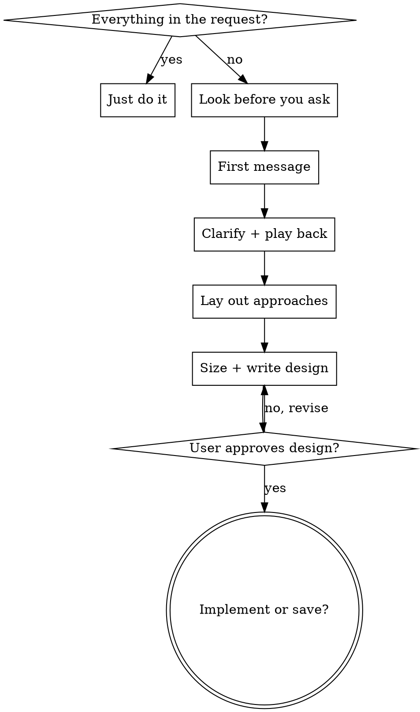

# Brainstorming Ideas Into Designs

## Overview

通过协作式对话，把想法变成成形的设计。目的是在动手前弄清用户**真正要什么、为什么**——懂了为什么，他没提到的那上百个小决定才能按他的方式做。

何时使用（镜像 frontmatter，防截断）：开新功能前先聊聊、把想法理清楚、设计一下再写、想法变设计；范围明确的纯改 bug / 重构 / 文档 / 代码问答跳过本 skill。

<HARD-GATE>
用户批准设计之前（小改动＝对话里的短设计，项目＝完整设计），不写产品代码、不 scaffold、不装依赖、不调任何实现类 skill。读代码和探查不受限。
例外只有两个：用户选择跳过提问（见「第一条消息」）；用户同意的一次性 spike（见「Spike」）。
</HARD-GATE>

## 先判断：你到底知道多少

回复前先问自己：关于他要什么、为什么，我知道多少？

- **要紧的信息请求里全有**（「把图标改成矢车菊蓝」）：直接做，说清做了什么。本 skill 到此结束。
- **缺了不简单的东西**：开始对话，按下面的步骤走。

## Checklist（必须按顺序）

- **步骤 1 — 先看再问** —— 读他提到的东西和相关代码
- **步骤 2 — 第一条消息** —— 复述 + 发现 + 一个问题
- **步骤 3 — 逐题澄清** —— 一次一个问题，边问边回放
- **步骤 4 — 摆方案** —— 单独一条消息，2-3 个方案带 tradeoff 和推荐，让他挑
- **步骤 5 — 定档、写设计** —— 小改动写短设计；项目写完整设计并做建造者自查
- **步骤 6 — 拿批准** —— 批准的是写出来的设计，不是对想法的口头附和
- **步骤 7 — 问去向** —— 直接实现，还是存到 `docs/designs/YYYY-MM-DD-<topic>.md`



## 先看再问

在已有项目里，或他给了上下文（spec、计划、交接、指给你的文件、前面的对话），发第一条消息前先钻进去：读他提到的东西和它连着的代码 / 材料，读到能讲清「相关部分现在怎么运作、这次改动会碰到什么」为止。**项目或上下文已经能回答的，绝不问。**

对话中途需要补查（代码、文件、数据、网页）就直接去查，不用先征求同意——查事实是你的活，做决定才是他的。

## 第一条消息

推进工作，二选一：

- **他已经说了要什么**（spec、计划、详细需求）：整条约 200 字。用自己的话复述需求——要什么、给谁、为什么（只写他说过的）；补上你查到的相关事实：相关部分现在怎么运作、改动会碰到什么；发现他可能没考虑到、会改变需求或做法的东西（约束、冲突、更省的路），直说。怎么造留到后面（见「摆方案」）。最后一行邀请纠正，再问**一个**关于「要什么」的问题：需求里还空着、答案最能改变产出的那一处。spec 常常不完整，动手前先确认。
- **还没说清**：问一个开放问题，用他自己的说法，问需求里最大的空白，并说明为什么问——答案会改变你造什么。例（给面包店做网站）：「如果主要是给路过的人决定要不要进店，我会把营业时间和今天柜台里有什么放最前面；要接单就是另一种站了。你希望人点进来之后做什么？」

结尾看触发方式：

- **他点名要**（说了 brainstorm / 设计一下 / 先聊聊，或手动调用）：以问题结尾。
- **模型自己判断触发的**：问题后加一句轻的退出口，如「如果你想让我直接开干，说一声」。他选直接干：用一行说明关键的「怎么造」选择（平台、语言、方案），然后照常做，本 skill 结束。

## 对话

- **每条消息只以一个问题结尾**：一句话，不挂一串示例答案。用他的说法、白话，别用流程黑话，也不用向他复述本 skill。
- **先让他描述**：问「要什么」先用开放题——他自己的话里带着选项给不出的意图。只有他卡住时才给短菜单（`AskUserQuestion`）。他说「你看着办」「你觉得呢」，就给具体提议。
- **带理由的提议常常胜过提问**：理由不明显时，说清你想知道什么、答案会改变什么。每个问题都贴着他的项目、他上一句话或你查到的东西，像敏锐的同事那样追问后果和漏掉的情况（「投票在会前截止，这个月有两人刚入会，中途入会的有没有投票权？」）。
- **怎么造的选择**（平台、语言、库、材料）：尽早弄清哪些他要自己定、哪些交给你、手上已有什么。有现成工作就沿用它已有的。你替他定的，在设计里写成**你的决定**，绝不写成他同意的。
- **要覆盖的地盘**（是范围不是剧本，别照念成问题）：这是个什么东西、特别在哪；为什么是现在、成功对他意味着什么；目标、非目标、反目标（技术上能跑但仍算失败的情况）；见过的同类、喜欢或讨厌的；现状、试过什么；他在意的细节。

## 边问边回放

某一部分你理解到能描述了（它为谁服务、某块怎么表现），就用约 200-300 字回放这一部分，再回到下一部分的问题。回放和提问交替进行，最后一段覆盖剩下的。

- **只有他说过的才算他的**；你补的一律写成「我的提议 + 理由」。
- 每段结尾问哪里不对、漏了什么。

## 摆方案

理解了要什么之后、写设计之前，**单独一条消息**摆出怎么造：

- 先想出多个真实备选，删掉弱的：和他的目的相悖的、被现有代码排除的
- 剩下 2-3 个，每个锚定项目现在实际怎么做，说清代价
- 先抛推荐的那个并给理由，再问他走哪条
- 真的只有一种合理做法时直说，并解释其他为什么不合适

这一步只管「怎么造」；「要什么」靠前面让他描述。

示例：

```
我推荐 **方案 A：复用现有 jotai atom**，理由是改动面最小、和现有状态流一致。

- 方案 A（推荐）：复用 xxxAtom，新增一个派生 atom。代价：派生逻辑略绕。
- 方案 B：新开 context。代价：和现有 atom 体系割裂，多一套心智。
- 方案 C：组件内 local state。代价：跨组件共享时要提升，后面会返工。

要按方案 A 往下到设计吗？
```

## Spike

一个用完就扔的快速原型，常常是弄清需求或验证可行性最便宜的办法，有用时主动提。他同意才做；spike 不写或少写测试、不求健壮、跳过设计流程；学到的东西带回对话。**要保留 spike 的产物是新请求**，回到 HARD-GATE。

## 定档、写设计

他挑定方案后，用白话说这活有多大，他可以推翻：

| 档 | 设计 |
|---|---|
| 小改动 | 短设计：把聊过的写下来，下面每节一两行，直接在对话里给他，不做建造者自查 |
| 项目 | 完整设计（骨架见下）+ 建造者自查 |

做到一半变大：停下、说出来、升档。其实是几个独立项目：说出来，商定顺序，一个一个聊。

### 设计骨架

读者是「该领域一个能干的建造者，不回头问他也能据此做计划」。每节篇幅按复杂度伸缩。

```
# <topic> 设计

## 目标 / 成功标准
<一句话目标 + 可验证的成功标准>

## 非目标 / 反目标
<不做什么；技术上能跑但仍算失败的情况>

## 约束
<平台、现有代码、时间、不能碰的东西>

## 方案选型
<考虑过的 2-3 个方案各自代价、选了哪个、为什么；他选的标他，你定的标你的决定>

## 架构与组件
<模块划分、关键文件路径>

## 数据流
<输入 → 处理 → 输出>

## 错误处理 / 边界
<会怎么坏、怎么兜>

## 测试
<怎么验证它真的对>

## 留给实现者的部分
<设计没定、实现时可自行决定的>
```

### 建造者自查（只在项目档）

设计写完后，按 [references/builder-check.md](references/builder-check.md) 派一个新上下文的子 agent，以建造者身份读设计。告诉他你在写设计、会先让一个审阅者读一遍、可能带几个问题回来一次。自查回来前不交设计。把建造者的问题分三堆：

- **已经答过**（对话或项目里有）：把答案写进设计
- **小事**（靠谱的建造者自己就能定、不改变造什么）：你来定，在设计里标「我的决定」
- **他的**（只有他能答、答案会改变造什么）：一条消息集中问，最重要的在前

更新设计后交给他，附一小段「我替你做的决定」清单，方便他边读边核。这是自查带来的唯一一轮提问。

## 批准之后

问他：

- **直接实现** —— 进入实现
- **存设计** —— 写到 `docs/designs/YYYY-MM-DD-<topic>.md`（不要 commit）

不要自动 commit，不要自动调用其他 skill。

## Red Flags

| 念头 | 现实 |
|---|---|
| 「先给几个选项让他挑想要什么」 | 选项会牵着人走。先让他描述。 |
| 「先填上合理的默认值」 | 可以，但要说出来。没听到的默认值他没法拒绝。 |
| 「问题都答完了，直接写设计」 | 先单独一条消息摆方案。 |
| 「他对想法说了『不错』」 | 批准只覆盖你给他看过的东西。没写出来的设计不算批准。 |
| 「spike 能跑了，接着往上盖」 | 保留它是新请求，回到 HARD-GATE。 |
| 「这个得先问问能不能去查」 | 查事实是你的活，直接查；只有决定交给他。 |
